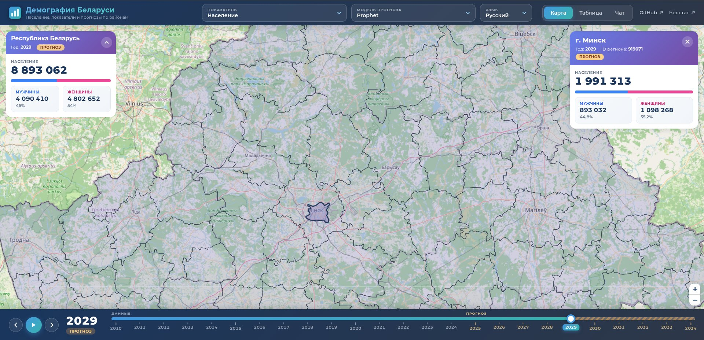
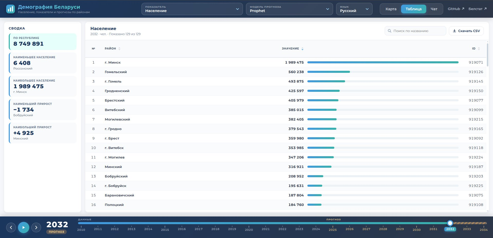
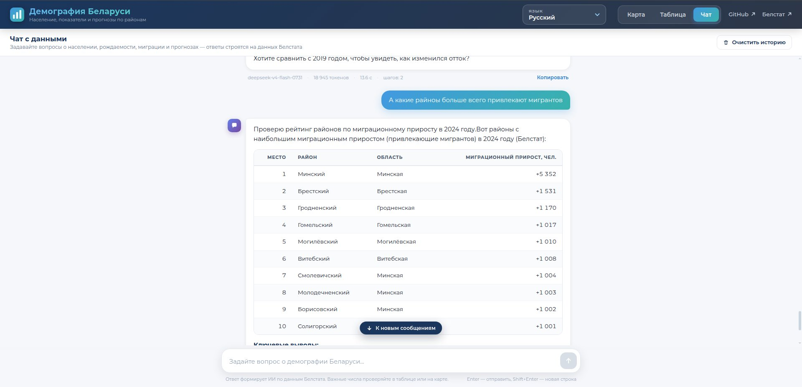

# Belarusian demography



## Acomplished tasks:
- Parsing SDMX-JSON datastructures from belstat. 
- Fetching data and saving to database.
- Forecasting future values using library Prophet.
- Creating FastAPI API for the web-frontend to receive data.
- Creating Frontend to display demographic data and forecasts.
- Loading additional Belstat indicators (births, deaths, marriages, divorces, migration, density) and forecasting them.
- Chat with the data: an LLM agent (OpenRouter) that answers questions in natural language using tools served by an MCP server.

## How to launch:
- Clone repository
```bash
git clone https://github.com/slavikovics/Demography
cd Demography
```
### Without docker:
- Go to data folder
```bash
cd data
```
- Create virtualenv
```bash
virtualenv .venv
```
If you don't have virtualenv installed:
```bash
pip3 install virtualenv
```
- Intall dependencies from requirements.txt

Go to your virtual environment:
```bash
source ./.venv/bin/activate
```
Insatll dependencies:
```bash
pip3 install -r requirements.txt
```
- Launch prepare.py as module.
This will download data from belstat API, create database and create all predictions. Creating forecasts may take a lot of time, if you don't need
predictions data, you can just terminate forecasting at any time.
```bash
python3 -m prepare
```
- After forecasting API will be automatically launched. If you have already loaded data, you can launch run.py as module, which will just start an API.
```bash
python3 -m run
```
- Go to Frontend folder, there:
```bash
npm install
```
- To launch Frontend:
```bash
npm start
```

### Using docker and docker-compose:
```bash
sudo docker compose build
sudo docker compose up
```

## Chat with the data (agent + MCP)
The **Chat** tab lets you ask questions in natural language ("Where was the birth rate highest in 2024?", "Compare migration by region").
The answer is built only from the database: a single LLM agent calls tools exposed by an MCP server, and every call is shown live in the UI.

```
Frontend (Chat tab) ──SSE──> FastAPI /chat/stream ──> agent loop (OpenRouter) ──MCP (streamable HTTP)──> mcp_server ──> demography.db (read-only)
```

### Setup
1. Create `data/.env` (it is git-ignored) from the template and put your OpenRouter key into it:
```bash
cp data/.env.example data/.env   # then set OPENROUTER_API_KEY
```
`OPENROUTER_MODEL` defaults to `~deepseek/deepseek-v4-flash-latest` (an alias; the resolved model is shown under each answer).
For a pinned version use e.g. `deepseek/deepseek-v4-flash`.
2. Install dependencies (`pip3 install -r requirements.txt`) and load data as described above.
3. Run three processes (from the `data` folder, inside the virtualenv):
```bash
python3 -m mcp_server     # MCP server, http://127.0.0.1:8000/mcp
python3 -m run            # API, http://localhost:5000
# and in Frontend/: npm start
```
With docker compose everything is started together (`mcp` runs as a separate service, its port is not published).

### Tools (MCP)
`list_indicators`, `search_territories`, `get_series`, `rank_territories`, `compare_years`, `region_totals`, `territory_profile`, and a restricted read-only `run_sql`.
The MCP server is standalone, so you can attach it to other clients too, e.g. `claude mcp add --transport http demography http://127.0.0.1:8000/mcp`.
Set `MCP_AUTH_TOKEN` (same value for the API and the MCP server) to require `Authorization: Bearer <token>`.

### Checks
```bash
python3 -m pytest data/tests -q                 # tools against the real database
python3 -m scripts.probe_openrouter             # capabilities of the model (streaming, tool calls, reasoning)
python3 -m scripts.eval_agent                   # reference questions; verifies that numbers in answers come from tool results
```
